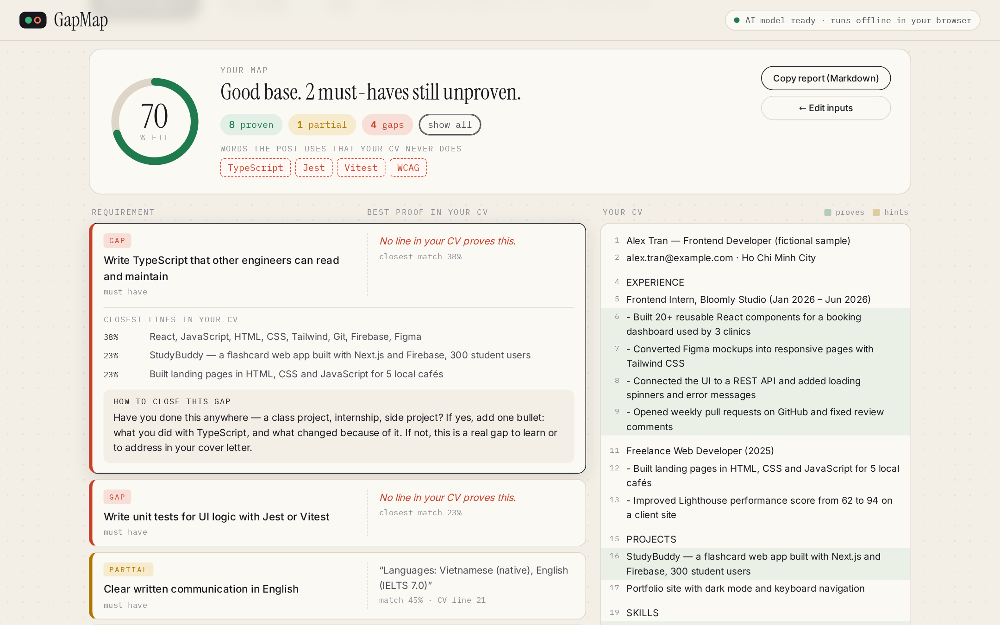

# GapMap

**Does your CV _prove_ what the job asks for?**
Paste a job post and your CV. GapMap links every requirement to the CV line that proves it — or flags it as a gap — using a small AI model that runs **entirely in your browser**. Nothing is uploaded.

**Live demo:** https://phamnghia1508.github.io/gapmap/
Built for Devpost's [Build With AI: Basics](https://learn-ai-basics.devpost.com/) with the [Devpost Learn Skill Pack](https://github.com/challengepost/learn-ai-basics).



## Why
Students and fresh graduates send the same CV to dozens of junior roles. Recruiters skim for *proof* of each requirement, and the usual options are guesswork or pasting your CV — phone number, address, work history — into a cloud chatbot that hands back a rewrite you can't verify. GapMap shows, line by line, what your CV already proves, what it only hints at, and what's missing, without your CV ever leaving your device.

## What it does
- **Requirement extraction** — splits the post into individual claims, skips "About us"/benefits, and marks nice-to-haves (worth half).
- **Evidence matching (the AI part)** — every requirement and CV line is embedded with **all-MiniLM-L6-v2** via **Transformers.js + WebAssembly**; cosine similarity plus a small exact-keyword bonus gives each requirement a status: **proven ≥ 52%**, **partial ≥ 42%**, otherwise **gap**.
- **Explainable results** — fit score, the best CV line for each requirement with its %, the top-3 closest lines, and click-to-highlight in your CV.
- **Missing words** — tools/acronyms the post uses that your CV never mentions (e.g. TypeScript, Jest, WCAG).
- **Honest next steps** — prompts ask "have you done this?" instead of inventing experience.
- **Re-map with delta** — edit your CV, map again, see "+N pts since your last map".
- **Private & offline** — model, runtime and fonts are served from this repo; inputs are saved only in your browser's `localStorage`. After the first load it keeps working offline.
- **Copy report** as Markdown.

## Try it
1. Open the [live demo](https://phamnghia1508.github.io/gapmap/) (first load downloads ~45 MB of model + runtime, then it's cached).
2. Click **Try a sample** (a fictional job post and CV) → **Map the gaps**.
3. Click rows to see evidence; add a bullet to the CV and map again.

## Run locally
No build step and no API keys.
```bash
git clone https://github.com/PhamNghia1508/gapmap.git
cd gapmap
python3 -m http.server 8000      # or: npm start
# open http://localhost:8000
```
(Opening `index.html` directly from disk won't work — browsers block ES modules/WebAssembly on `file://`.)

Tests (Node 18+, no dependencies):
```bash
npm test
```

## How it works
```
job post ─┐                      ┌─ requirement vectors ─┐
          ├─ engine.split*() ──▶ model.embed() (MiniLM, WASM) ──▶ engine.scoreMatches() ──▶ app.render()
your CV ──┘                      └─ evidence vectors ────┘
```
| File | Role |
|---|---|
| `index.html`, `css/style.css` | the page and its look |
| `js/app.js` | UI: inputs, run flow, rendering, filters, highlight, report |
| `js/engine.js` | pure logic: splitting, scoring, statuses, prompts, Markdown |
| `js/model.js` | Transformers.js configured for local-only files |
| `vendor/`, `models/` | ONNX Runtime Web + quantised all-MiniLM-L6-v2 weights |
| `tests/engine.test.mjs` | unit tests for the engine |
| `devpost/` | planning docs from the Skill Pack: `scope.md`, `prd.md`, `spec.md`, `checklist.md`, `app-map.html` |

## Built with the Devpost Learn Skill Pack
Planned and built from an empty folder with `npx skills add challengepost/learn-ai-basics --all -y` (installed under `.agents/skills/`): `2-scope` → `devpost/scope.md`, `3-prd` → `devpost/prd.md`, `4-spec` → `devpost/spec.md`, `5-build` → `devpost/checklist.md` + `devpost/app-map.html`.

## Limits
- English job posts work best (the model is English-trained).
- A small model can miss domain synonyms (e.g. "keyboard navigation" vs "WCAG"); the % and the closest lines are always shown so you can judge.
- Not an ATS simulator and not a guarantee of anything — it's a checklist with evidence.

## Credits & licences
- Code: MIT © 2026 Phạm Nhật Nghĩa — see [LICENSE](LICENSE).
- [Transformers.js](https://github.com/huggingface/transformers.js) (Apache-2.0) and [ONNX Runtime Web](https://onnxruntime.ai/) (MIT), vendored unmodified in `vendor/`.
- Model: [Xenova/all-MiniLM-L6-v2](https://huggingface.co/Xenova/all-MiniLM-L6-v2) (Apache-2.0), from [sentence-transformers/all-MiniLM-L6-v2](https://huggingface.co/sentence-transformers/all-MiniLM-L6-v2).
- Fonts: Instrument Serif, Inter, IBM Plex Mono (SIL OFL 1.1).
- Sample job post and CV are fictional.
